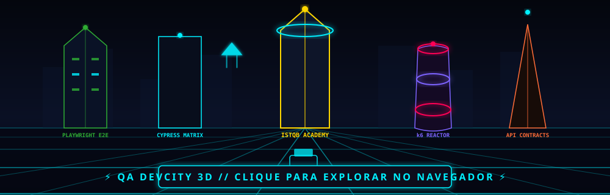

<div align="center">

  <!-- Header Banner / Typing SVG Formal & Clean -->
  <a href="https://github.com/QA-VictorValente">
    
  </a>

  <p align="center">
    <b>Analista de Qualidade de Software (QA Full / Automação)</b> com mais de <b>4 anos de experiência</b> garantindo robustez, confiabilidade e estabilidade de aplicações críticas através de testes contínuos e arquiteturas modernas de automação.
  </p>

  <p align="center">
    <a href="https://www.linkedin.com/in/victor-valente-59a3161a4/" target="_blank">
      
    </a>
    <a href="mailto:victorvalente456@gmail.com?subject=Contato%20Profissional%20-%20QA%20Victor%20Valente">
      
    </a>
  </p>

</div>

---

### ⚡ Resumo Profissional

```json
{
  "nome": "Victor Valente",
  "cargo": "Analista de Qualidade de Software (QA)",
  "experiencia": "4+ anos",
  "especialidades": [
    "Automação Web E2E (Playwright, Cypress, Selenium)",
    "Validação e Contratos de APIs (Zod, TypeScript, Postman)",
    "Testes de Performance e Carga (Grafana k6)",
    "Auditoria e Validação em Banco de Dados (PostgreSQL, Oracle)",
    "Preparação Oficial ISTQB CTFL v4.0.1"
  ],
  "proposito": "Prevenir defeitos antes do ambiente produtivo e elevar a maturidade técnica de engenharia."
}
```

---

### 🎯 Escopo de Atuação & Metodologia

- 🧪 **Estratégia & Planejamento:** Elaboração de planos de teste, matriz de rastreabilidade, critérios de aceite (BDD/Gherkin) e homologação com áreas de negócio.
- 🔄 **Ciclo Completo de Testes:** Funcionais, Exploratórios, Regressão, Sanity, Smoke e Integração contínua.
- 🤖 **Automação Resiliente:** Arquiteturas modernas com Page Object Model (POM), App Actions, validação de contratos e Network Mocking (`cy.intercept`).
- ⚡ **Performance & Carga:** Testes de estresse e SLAs de resposta utilizando Grafana k6 com estágios progressivos.
- 🗄️ **Auditoria & Integridade de Dados:** Validações analíticas de regras de negócio em bancos relacionais com SQL avançado.
- 🏃 **Cultura Ágil:** Atuação próxima aos times de engenharia em rituais Scrum/Kanban e acompanhamento ponta a ponta no Jira e Azure DevOps.

---

### 🛠️ Tecnologias & Ferramentas

<div align="center">

#### 🧪 Automação E2E & Performance
<p>
  
  
  
  
  
  
</p>

#### 🔌 APIs & Validação de Contrato
<p>
  
  
  
  
  
</p>

#### 🗄️ Bancos de Dados & SQL
<p>
  
  
  
</p>

#### ⚙️ Gestão, DevOps & Metodologias
<p>
  
  
  
  
  
  
</p>

</div>

---

### 🚀 Projetos em Destaque

| Projeto | Descrição | Stack |
| :--- | :--- | :--- |
| 🧪 [**qa-web-playwright-saucedemo**](https://github.com/QA-VictorValente/qa-web-playwright-saucedemo) | Automação E2E moderna utilizando Page Object Model (POM), relatórios detalhados e TypeScript. | `Playwright` `TypeScript` `POM` |
| 🌐 [**qa-web-cypress-conduit**](https://github.com/QA-VictorValente/qa-web-cypress-conduit) | Testes E2E robustos com Cypress, arquitetura em App Actions e Network Mocking via `cy.intercept`. | `Cypress` `Network Mocking` |
| 🔌 [**qa-api-playwright-serverest**](https://github.com/QA-VictorValente/qa-api-playwright-serverest) | Testes automatizados de API com validação estrita de schemas e contratos usando Zod. | `Playwright API` `Zod` `REST` |
| ⚡ [**qa-perf-k6-serverest**](https://github.com/QA-VictorValente/qa-perf-k6-serverest) | Testes de performance, estresse e validação de SLAs de latência com Grafana k6. | `Grafana k6` `Performance` |
| 🎓 [**CTFL-Academy**](https://github.com/QA-VictorValente/CTFL-Academy) | Plataforma interativa de preparação para a certificação oficial ISTQB CTFL v4.0.1. | `Next.js` `ISTQB CTFL` |

---

### 📊 Métricas & Desempenho

<div align="center">

  
  

  <br/><br/>

  

</div>

---

### 🏙️ QA City: Metrópole da Qualidade

<div align="center">

> *"Cada dia é um lote, cada commit constrói a cidade da engenharia de software."* 🏢🌿

<p align="center">
  <a href="https://qa-victorvalente.github.io/QA-VictorValente/" target="_blank" title="Clique para explorar a cidade interativa 3D">
    
  </a>
</p>

<p align="center">
  <a href="https://qa-victorvalente.github.io/QA-VictorValente/" target="_blank">
    
  </a>
</p>

</div>

#### 🏛️ Arquitetura Visual dos Lotes:
- 🌳 **Praça com Jardim (0 Commits):** Lote arborizado com gramado, caminho de pedras e bancos (dia de descanso/planejamento).
- 🏡 **Casa com Telhado Inclinado (1 a 3 Commits):** Residência moderna com telhado gabled, chaminé e jardim frontal.
- 🏢 **Edifício Comercial com Terraço (4 a 7 Commits):** Prédio corporativo com fachada envidraçada e jardim suspenso no topo.
- 🏛️ **Arranha-Céu com Heliponto (8+ Commits):** Torre monumental icônica com heliponto, antena de sinalização e alta produtividade.

---

### 🟩 Histórico Contínuo de Commits (365 Dias)

<div align="center">
  
  <p><sub>Atualizado dinamicamente em tempo real a cada novo commit realizado. ⚡</sub></p>
</div>

---

<div align="center">
  <sub>Construído com foco em qualidade contínua, governança técnica e tolerância zero a falhas. 🚀</sub>
</div>
